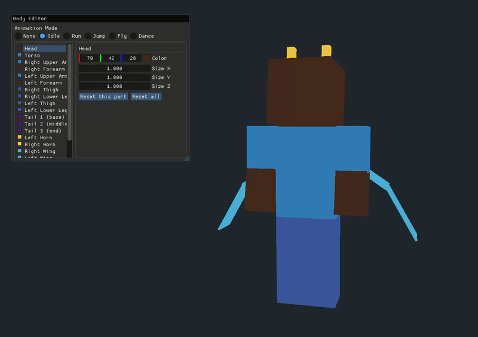
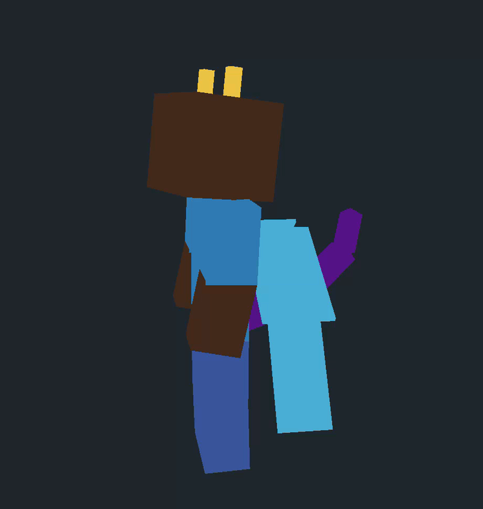
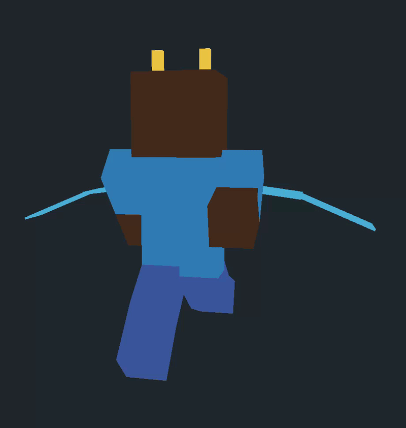
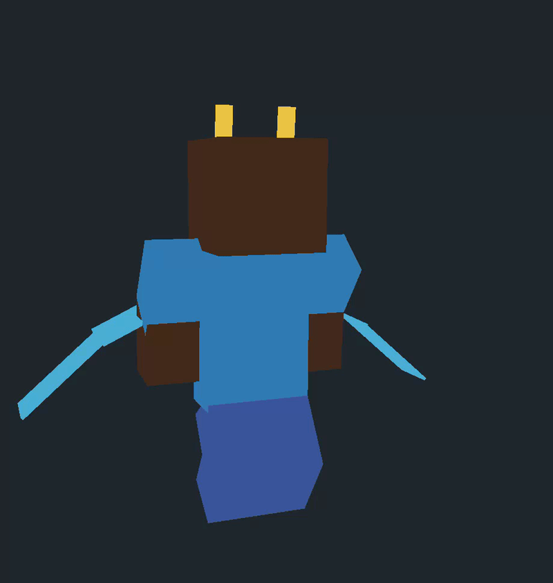
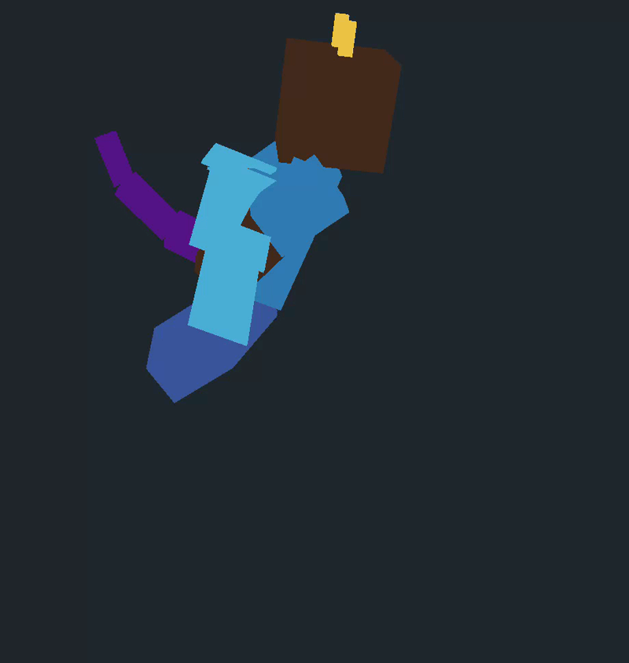
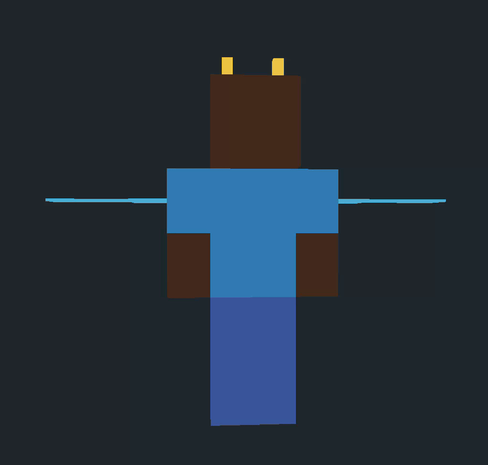

# humangl

**humangl** is a lightweight OpenGL project that brings a stylized humanoid creature to life through hierarchical modeling, procedural animations, and real-time customization.

Built with OpenGL and Dear ImGui, the project features an interactive 3D character whose body parts, proportions, and colors can be adjusted through a live editor while animations run in real time.

## Overview

The project explores the fundamentals of 3D graphics and character animation, combining:

- **OpenGL** for 3D rendering
- **GLFW** for window creation and input handling
- **GLAD** for OpenGL function loading
- **Dear ImGui** for the interactive body editor
- **Custom transform hierarchy** for organizing and animating body parts

The goal is to create an interactive character using hierarchical transformations, simple animation systems, and real-time editing tools without relying on a full game engine.

## Features

- **Hierarchical modeling** — A custom humanoid character assembled from connected `CordFrame` transforms.
- **Multiple animations** — Idle, running, jumping, flying, and dancing animation modes.
- **Live body editor** — Adjust body-part proportions, sizes, and colors in real time.
- **Camera controls** — Rotate, inspect, zoom, and navigate around the 3D model.
- **Custom shaders** — GLSL vertex and fragment shaders for rendering.
- **Modular architecture** — Separate components for the character, camera, input, transformations, rendering, and user interface.

## Build and Run

### Requirements

- A C++ compiler supporting C++17
- GNU Make
- OpenGL
- GLFW
- The project's GLAD and Dear ImGui dependencies

### Compile

From the project root, run:

```bash
make
```

### Run

After a successful build, launch the application with:

```bash
./humangl
```

### Clean

Remove intermediate build artifacts:

```bash
make clean
```

Remove build artifacts and the compiled executable:

```bash
make fclean
```

## Controls

Interact with the character using the mouse and keyboard. The Dear ImGui editor provides additional controls for customizing the model.

| Input | Action |
|---|---|
| Mouse drag | Rotate the model |
| Mouse scroll | Zoom in and out |
| W / A / S / D | Move the camera |
| Space / Shift | Move vertically |
| Escape | Exit the application |

## Gallery

### Body Editor



Customize the character's body parts and appearance through the interactive editor.

### Animations

**Idle Pose**



**Running**



**Jumping**



**Flying**



**Default Pose**



## About the Project

humangl is an educational graphics project focused on understanding how 3D characters can be constructed, transformed, and animated from the ground up.

Rather than relying on a large engine or an existing character-animation framework, it uses direct OpenGL rendering and custom mathematical utilities to explore:

- Hierarchical transformations and parent-child relationships
- Character construction from individual 3D components
- Animation through transform updates
- Interactive parameter editing with Dear ImGui
- The relationship between rendering, input, and animation systems

The project serves as a foundation for experimenting with 3D graphics, character animation, and real-time visual tools.
